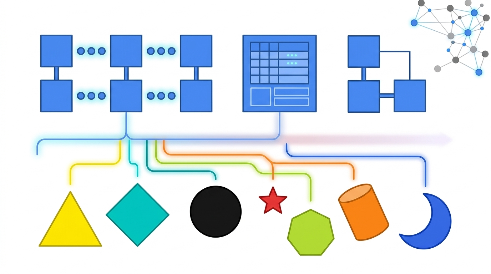

# Abstração e Generalização

Guia introdutório sobre abstração: como observar o mundo real, filtrar o que importa e generalizar em estruturas computacionais reutilizáveis. Inclui um exemplo de modelagem em PHP e a importância da generalização na arquitetura de sistemas.

## Sumário

1. [O conceito de abstração e generalização](#o-conceito-de-abstração-e-generalização)
2. [Como classificar dados e criar representações](#como-classificar-dados-e-criar-representações)
3. [Exemplo visual](#exemplo-visual)
4. [Exemplo prático: modelagem da entidade Estudante (PHP)](#exemplo-prático-modelagem-da-entidade-estudante-php)
5. [O poder da generalização na arquitetura](#o-poder-da-generalização-na-arquitetura)

## O conceito de abstração e generalização

- **Abstrair:** observar elementos do mundo real avaliando suas características e propriedades de forma isolada, descartando ruídos e focando apenas no que importa.
- **Transcrição computacional:** a abstração é a base da Programação Orientada a Objetos (POO), que transforma objetos físicos ou conceitos abstratos do mundo real em estruturas computacionais.
- **Regra de ouro:** ao abstrair, é obrigatório generalizar. Na lógica, a generalização é a operação intelectual que reúne objetos ou fenômenos similares em uma classe geral.

## Como classificar dados e criar representações

Para abstrair corretamente um sistema, siga o fluxo:

1. **Detalhar características:** mapear tudo o que pertence ao objeto.
2. **Filtrar pontos essenciais:** definir o que o sistema realmente precisa saber para funcionar.
3. **Generalizar cada elemento:** agrupar propriedades comuns em moldes reutilizáveis (classes e estruturas).
4. **Criar a representação digital:** chegar ao modelo computacional final.

## Exemplo visual



Na imagem, elementos do mundo real, representados por formas geométricas variadas e distintas, são abstraídos, processados e generalizados em estruturas computacionais uniformes e organizadas.

## Exemplo prático: modelagem da entidade Estudante (PHP)

A regra aplicada: os dados essenciais viram **atributos** e os dados extras ou ações viram **métodos**.

```php
namespace App\Models;

class Estudante
{
    // Atributos Essenciais
    public string $nome;
    public string $matricula;
    public string $campus;
    public string $telefone;

    // Construtor para inicializar os dados essenciais
    public function __construct(string $nome, string $matricula, string $campus, string $telefone)
    {
        $this->nome = $nome;
        $this->matricula = $matricula;
        $this->campus = $campus;
        $this->telefone = $telefone;
    }

    // Métodos / Ações Extras (Comportamentos)
    public function getTrabalho(): string
    {
        return "Este estudante possui vínculo empregatício ativo.";
    }

    public function getLivroPreferido(): string
    {
        return "Introdução ao Pensamento Computacional";
    }

    public function getQuantidadeFilhos(): int
    {
        return 0;
    }

    /**
     * Método para listar/retornar os dados consolidados do estudante
     */
    public static function listados(array $estudantes): array
    {
        $listaFormatada = [];

        foreach ($estudantes as $estudante) {
            $listaFormatada[] = [
                'nome'       => $estudante->nome,
                'matricula'  => $estudante->matricula,
                'campus'     => $estudante->campus,
                'telefone'   => $estudante->telefone,
                'livro'      => $estudante->getLivroPreferido(),
            ];
        }

        return $listaFormatada;
    }
}
```

| Parte da classe | O que representa na abstração |
|---|---|
| `nome`, `matricula`, `campus`, `telefone` | Dados **essenciais**, o que o sistema precisa saber sobre o estudante |
| `getTrabalho()`, `getLivroPreferido()`, `getQuantidadeFilhos()` | Dados **extras** e comportamentos, fora do núcleo essencial |
| `listados()` | Generalização: um único método que formata qualquer lista de estudantes |

> **Observação:** os métodos extras retornam valores fixos apenas para ilustrar a ideia. Em um sistema real, esses dados viriam de um banco de dados.

## O poder da generalização na arquitetura

A generalização trazida pela abstração não serve apenas para classes isoladas. Ela é a fundação da engenharia de software avançada:

- **Algoritmos de pesquisa:** reutilização de buscas genéricas para qualquer tipo de dado.
- **Estruturas de dados:** pilhas, filas e árvores.
- **Máquinas de estado finito.**
- **Camadas de rede:** modelo OSI e TCP/IP.

**Conclusão:** toda arquitetura de sistemas sólida é, essencialmente, uma camada de abstração bem desenhada.