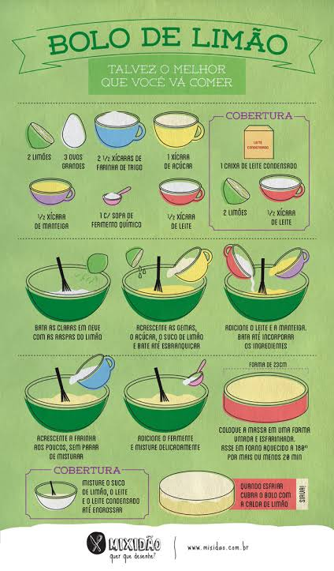
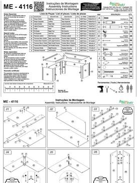
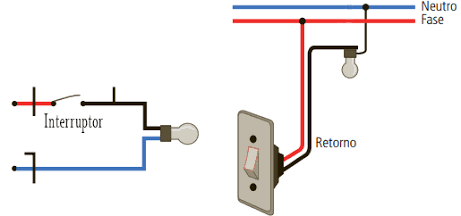

# Algoritmos

O algoritmo é o coração da execução. Ele não opera sozinho: exige instruções detalhadas e estruturadas, que precisam ser compreendidas tanto por humanos quanto por máquinas.

O objetivo computacional central é este:

**Entrada (input) → Processamento (regras lógicas) → Saída (output)**

Ou seja: receber dados de entrada, processá-los seguindo regras lógicas e armazenar ou entregar o resultado.

Para ilustrar de forma simples e visual como um algoritmo funciona na prática (passo a passo detalhado, fluxo de valor e descrição de solução), veja três exemplos do cotidiano.

## Sumário

1. [Exemplo 1: receita culinária](#exemplo-1-receita-culinária)
2. [Exemplo 2: manual de montagem de móveis](#exemplo-2-manual-de-montagem-de-móveis)
3. [Exemplo 3: circuito elétrico simples](#exemplo-3-circuito-elétrico-simples)
4. [Resumo dos exemplos](#resumo-dos-exemplos)

## Exemplo 1: receita culinária

<table>
  <tr>
    <td width="55%" valign="top">
      
    </td>
    <td width="45%" valign="top">
      <h3>Receita culinária (passo a passo)</h3>
      
Uma receita de bolo funciona exatamente como um algoritmo clássico:

      <ul>
        <li><b>Entrada:</b> os ingredientes.</li>
        <li><b>Processamento:</b> os passos sequenciais (misturar, bater, assar).</li>
        <li><b>Saída:</b> o bolo pronto.</li>
      </ul>
    </td>
  </tr>
</table>

## Exemplo 2: manual de montagem de móveis

<table>
  <tr>
    <td width="55%" valign="top">
      
    </td>
    <td width="45%" valign="top">
      <h3>Manual de montagem de móveis</h3>
      
Aqui o algoritmo traduz um problema físico complexo em ações sequenciais estritas. Cada etapa depende da anterior (<b>ordem sequencial</b>), detalhando:

      <ul>
        <li>as peças necessárias;</li>
        <li>a forma de encaixe;</li>
        <li>o resultado esperado.</li>
      </ul>
    </td>
  </tr>
</table>

## Exemplo 3: circuito elétrico simples

<table>
  <tr>
    <td width="55%" valign="top">
      
    </td>
    <td width="45%" valign="top">
      <h3>Interruptor e lâmpada</h3>
      
Um algoritmo lógico binário e direto:

      <ul>
        <li><b>Se</b> o interruptor estiver fechado (ligado), a corrente flui (processamento) e a lâmpada acende (saída).</li>
        <li><b>Se</b> estiver aberto, o fluxo é interrompido.</li>
      </ul>
    </td>
  </tr>
</table>

## Resumo dos exemplos

| Exemplo | Entrada | Processamento | Saída |
|---|---|---|---|
| **Receita de bolo** | Ingredientes | Passos sequenciais: misturar, bater, assar | Bolo pronto |
| **Montagem de móveis** | Peças e ferramentas | Etapas em ordem sequencial, cada uma dependendo da anterior | Móvel montado |
| **Interruptor e lâmpada** | Posição do interruptor (aberto ou fechado) | Se fechado, a corrente flui; se aberto, o fluxo é interrompido | Lâmpada acesa ou apagada |