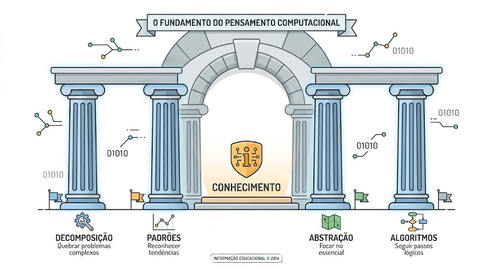

# Pensamento Computacional

Guia introdutório sobre o conceito de Pensamento Computacional (PC): origem, pilares, evidências científicas e aplicações em diferentes áreas.

## Sumário

1. [Origem e definição](#origem-e-definição)
2. [Os quatro pilares](#os-quatro-pilares)
3. [Evidências científicas](#evidências-científicas)
4. [Aplicações multidisciplinares](#aplicações-multidisciplinares)
5. [Conclusão](#conclusão)

## Origem e definição

O termo ganhou notoriedade em 2006, com o artigo de Jeannette Wing (Carnegie Mellon) na revista *Communications of the ACM*. Wing defende que o PC deve ser uma habilidade universal, ao lado de leitura, escrita e aritmética.

Segundo Wing (2006, 2011), o PC envolve:

- Resolver problemas, projetar sistemas e entender o comportamento humano com base em conceitos da ciência da computação
- Pensar em múltiplos níveis de abstração
- Lidar com complexidade e incerteza
- Automatizar soluções por meio de processos lógicos e estruturados

## Os quatro pilares

A imagem no topo resume os quatro pilares que sustentam o PC. Cada um tem um papel na decomposição e resolução de problemas complexos:

| Pilar | O que é | Exemplo |
|---|---|---|
| **Decomposição** | Quebrar um problema complexo em partes menores e gerenciáveis | Organizar um evento: orçamento, convites, buffet, local e atrações |
| **Reconhecimento de padrões** | Identificar semelhanças, tendências e regularidades | Perceber que relatórios financeiros falham sempre pelos mesmos erros de digitação |
| **Abstração** | Filtrar detalhes irrelevantes e focar no essencial | Um mapa rodoviário omite árvores e construções para destacar rotas e distâncias |
| **Algoritmos** | Criar instruções passo a passo, claras e não ambíguas | Uma receita culinária |

## Evidências científicas

**Revisões e estudos fundacionais**
- Grover & Pea (2013): o ensino de PC na educação básica melhora o desempenho técnico e também habilidades de ordem superior, como metacognição, pensamento crítico e resolução de problemas.
- Lye & Koh (2014): ferramentas visuais de programação favorecem estratégias cognitivas avançadas e persistência.

**Transferência de aprendizagem e funções executivas**
- Pesquisas (Wing, 2008; Barr & Stephenson, 2011) indicam que decomposição e pensamento algorítmico trazem ganhos em matemática, lógica e humanidades.
- A prática de resolução de problemas computacionais estimularia funções executivas: memória de trabalho, flexibilidade cognitiva e controle inibitório.

**Educação infantil e básica**
- O PC *unplugged* (sem computadores, com jogos, cartas e dinâmicas corporais) já traz ganhos na compreensão lógica a partir dos 5 anos.
- Metanálises sugerem que o PC atua como um equalizador cognitivo entre diferentes origens socioeconômicas.

## Aplicações multidisciplinares

| Área | Aplicação |
|---|---|
| Biologia e Medicina | Sequenciamento de DNA e modelagem da propagação de epidemias |
| História e Humanidades | Mineração de dados em grandes volumes de textos digitalizados |
| Administração e Negócios | Mapeamento de processos, otimização logística e análise de tendências |
| Direito e Justiça | Análise de jurisprudência e estruturação de argumentos lógicos (se/então) |

## Conclusão

O PC vai além das telas e do código: é uma forma de abordar problemas complexos que transforma ambiguidade em clareza estruturada, sendo uma competência essencial do século XXI.

## Referências citadas

- Wing, J. M. (2006). Computational Thinking. *Communications of the ACM*.
- Wing, J. M. (2008, 2011).
- Grover, S., & Pea, R. (2013). Computational Thinking in K-12: A Review of the State of the Field.
- Lye, S. Y., & Koh, J. H. L. (2014). Review on teaching and learning of computational thinking through programming.
- Barr, V., & Stephenson, C. (2011).