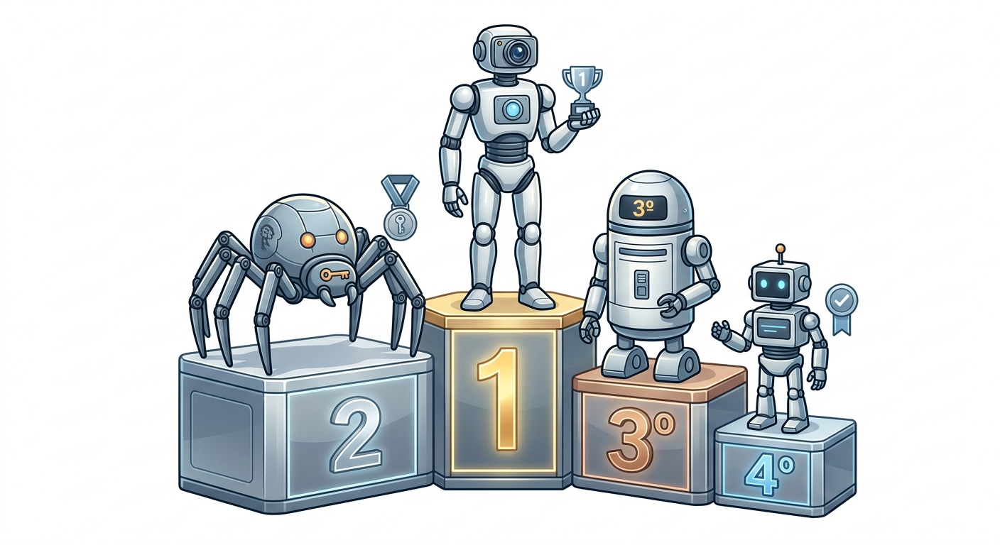

# Raciocínio Lógico

Guia introdutório sobre raciocínio lógico: o conceito, as formas de inferência (indução, dedução e abdução), o aperfeiçoamento e um exemplo prático com desafios de lógica.

## Sumário

1. [O que é](#o-que-é)
2. [Formas de inferência](#formas-de-inferência)
3. [Aperfeiçoamento](#aperfeiçoamento)
4. [Exemplo prático: desafios de lógica com robôs](#exemplo-prático-desafios-de-lógica-com-robôs)

## O que é

Forma de pensamento estruturado que permite chegar a uma conclusão ou resolver um problema. Na prática, é a "mão na massa" que ajuda a quebrar um problema complexo em etapas menores, conectando-se diretamente aos fundamentos do pensamento computacional.

> **Aviso importante:** o raciocínio funciona como um músculo e precisa ser exercitado. O uso passivo ou desregulado de Inteligências Artificiais para pensar por você pode prejudicar o desenvolvimento cognitivo.

## Formas de inferência

| Tipo | Como funciona | Exemplo |
|---|---|---|
| **Indução** | Parte de observações empíricas repetidas para chegar a uma regra geral | "A massa sempre cai para baixo, logo a gravidade existe" |
| **Dedução** | Chega a uma resposta definitiva a partir de uma linha lógica ou cronológica de informações; muito usada na matemática | Aplicar uma regra geral a um caso específico |
| **Abdução** | Parte de um resultado observado e supõe sua causa mais provável | "A grama está molhada, portanto deve ter chovido hoje" |

## Aperfeiçoamento

Habilidade e processo de melhorar o que já está pronto: otimizar processos, aumentar a eficiência e reduzir o desperdício de tempo ou recursos.

## Exemplo prático: desafios de lógica com robôs

Para praticar esses conceitos, uma boa opção são os desafios de lógica em formato de quebra-cabeça. Um texto descreve regras e características (robôs com funções, ordens cronológicas, propriedades específicas) e, por meio de deduções passo a passo, é preciso descobrir a sequência correta dos acontecimentos ou a classificação final em um pódio de 1º a 4º lugar.

