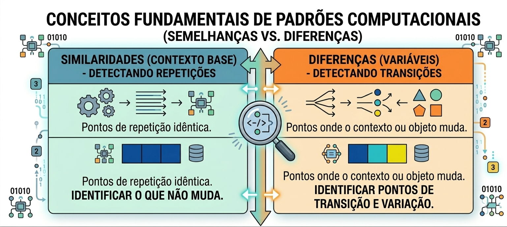
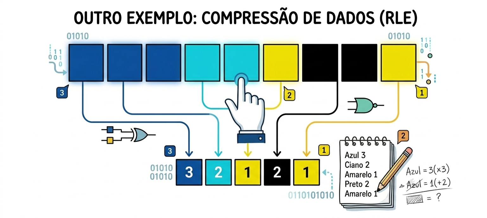
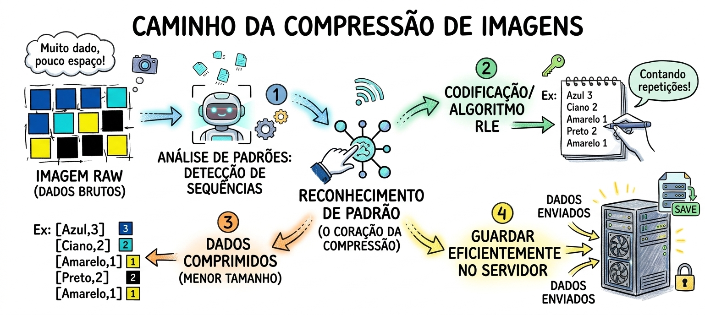

# Reconhecimento de Padrões

Guia introdutório sobre reconhecimento de padrões na computação: como identificar o que se repete e o que muda, como isso leva à padronização do código, como aparece na compressão de dados, como uma máquina aprende a enxergar padrões por si mesma e em quais áreas de T.I. a padronização é aplicada.

## Sumário

1. [Semelhanças e diferenças](#semelhanças-e-diferenças)
2. [Padrões no código: padronização (DRY)](#padrões-no-código-padronização-dry)
   - [Exemplo: antes e depois](#exemplo-antes-e-depois)
   - [10 lugares do código onde a padronização é aplicada](#10-lugares-do-código-onde-a-padronização-é-aplicada)
3. [Exemplo: compressão de dados (RLE)](#exemplo-compressão-de-dados-rle)
4. [Como fazer a máquina enxergar padrões](#como-fazer-a-máquina-enxergar-padrões)
5. [10 áreas de T.I. onde a padronização é aplicada](#10-áreas-de-ti-onde-a-padronização-é-aplicada)

## Semelhanças e diferenças

Reconhecer padrões é olhar para o problema de duas formas complementares:



| | Similaridades (contexto base) | Diferenças (variáveis) |
|---|---|---|
| **O que detecta** | Repetições | Transições |
| **Onde atua** | Pontos de repetição idêntica | Pontos onde o contexto ou o objeto muda |
| **Objetivo** | Identificar o que **não muda** | Identificar pontos de **transição e variação** |

## Padrões no código: padronização (DRY)

Quando o mesmo trecho de código aparece em vários lugares, há um padrão a ser reconhecido. Generalizá-lo em uma única estrutura reutilizável é a **padronização**, conhecida como princípio **DRY** (*Don't Repeat Yourself*) e parte do Clean Code.

### Exemplo: antes e depois

**Antes:** a mesma lógica de busca se repete em cada método.

```php
public function show(int $id)
{
    $user = User::findOrFail($id);

    return $user;
}

public function edit(int $id)
{
    $user = User::findOrFail($id);

    return $user;
}
```

**Depois:** a operação repetida é centralizada em um método reutilizável.

```php
private function findUser(int $id): User
{
    return User::findOrFail($id);
}

public function show(int $id)
{
    return $this->findUser($id);
}

public function edit(int $id)
{
    return $this->findUser($id);
}
```

### O que o exemplo demonstra

| Conceito | O que o código mostra |
|---|---|
| **Identificar semelhanças** | Perceber que a mesma operação aparece em diferentes métodos |
| **Generalizar padrões** | Extrair a operação repetida para uma função |
| **Eliminar redundância** | Reutilizar a função em vez de repetir a implementação |
| **DRY** | Manter uma única implementação da lógica de busca |

Esse é o reconhecimento de padrões feito **pelo programador**: perceber estruturas semelhantes e abstraí-las. Em Machine Learning, quem identifica as regularidades é o sistema, a partir dos dados.

> **Nota sobre autenticação:** este exemplo foi escolhido de propósito sem autenticação, para não misturar dois conceitos. Autenticação deve ser estudada à parte. Em especial, `Auth::login($user)` apenas inicia a sessão do usuário, sem verificar senha ou credenciais. Autenticar alguém só por um ID recebido em uma requisição é uma falha grave de segurança. Para validar credenciais, use mecanismos próprios, como `Auth::attempt()`.

### Como identificar um candidato à padronização

- O mesmo trecho aparece em **três ou mais lugares**.
- Ao corrigir um erro, é preciso **alterar vários arquivos** para o mesmo ajuste.
- As cópias são **quase idênticas**, mudando apenas alguns valores (que viram parâmetros da função generalizada).

### 10 lugares do código onde a padronização é aplicada

Os exemplos de ferramentas usam o Laravel, mas a ideia vale para qualquer linguagem ou framework.

| # | Onde | O que se repetia | Como é padronizado |
|---|---|---|---|
| 1 | **Autenticação** | Verificar credenciais em vários pontos do sistema | Um único mecanismo de autenticação (como `Auth::attempt()` em um serviço ou *middleware*) |
| 2 | **Validação de dados** | As mesmas regras (e-mail, senha, campos obrigatórios) em vários formulários | Classes de validação reutilizáveis (*Form Requests*) |
| 3 | **Consultas ao banco de dados** | Os mesmos filtros e buscas escritos em cada controlador | Repositórios ou *scopes* nos modelos |
| 4 | **Respostas de API** | Montar o JSON de sucesso e de erro de formas diferentes | Um formato único de resposta (*API Resources* ou *helper* de resposta) |
| 5 | **Tratamento de erros** | Blocos `try/catch` copiados em cada função | Um tratador global de exceções |
| 6 | **Logs e auditoria** | Registrar "quem fez o quê" manualmente em cada ação | *Middleware* ou *observers* que registram automaticamente |
| 7 | **Permissões e autorização** | Verificações de "este usuário pode fazer isso?" espalhadas pelo código | Políticas de acesso centralizadas (*Policies* e *Gates*) |
| 8 | **Envio de e-mails e notificações** | Montar e disparar mensagens de formas parecidas em vários pontos | Um serviço de notificação com modelos de mensagem |
| 9 | **Interface (telas)** | O mesmo botão, formulário ou cartão copiado em várias páginas | Componentes reutilizáveis (*Blade components*, React, Vue) |
| 10 | **Paginação e filtros de listagem** | A mesma lógica de ordenar, filtrar e paginar em cada listagem | Uma função ou classe genérica de listagem |

## Exemplo: compressão de dados (RLE)

Na compressão por **RLE** (*Run-Length Encoding*), o padrão é a repetição de valores consecutivos. Em vez de guardar cada bloco individualmente, guarda-se a cor e quantas vezes ela se repete em sequência.



| Sequência original | Codificação |
|---|---|
| 3 blocos azuis | Azul 3 |
| 2 blocos ciano | Ciano 2 |
| 1 bloco amarelo | Amarelo 1 |
| 2 blocos pretos | Preto 2 |
| 1 bloco amarelo | Amarelo 1 |

### O caminho da compressão de imagens

O reconhecimento de padrão é o coração da compressão. O processo completo passa por quatro etapas:



1. **Análise de padrões:** detecção de sequências na imagem bruta (dados brutos, muito dado e pouco espaço).
2. **Codificação (algoritmo RLE):** contagem das repetições.
3. **Dados comprimidos:** o resultado ocupa menos espaço (ex.: `[Azul,3]`, `[Ciano,2]`, `[Amarelo,1]`, `[Preto,2]`, `[Amarelo,1]`).
4. **Guardar eficientemente no servidor:** os dados comprimidos são enviados e armazenados.

## Como fazer a máquina enxergar padrões

Para que um sistema computacional ou uma inteligência artificial deixe de apenas executar regras rígidas e passe a enxergar padrões por si mesmo, é necessário transitar pelo campo da representação de dados e do aprendizado de máquina (*Machine Learning*). O processo ocorre em três etapas.

### 1. Representação de atributos (*Feature Representation*)

Antes que qualquer padrão seja detectado, a máquina precisa converter o mundo real (ou dados brutos) em estruturas matemáticas compreensíveis.

- **O que é:** cada objeto ou dado é decomposto em uma lista de atributos ou características mensuráveis (vetores numéricos). Por exemplo, em vez de "ver" um rosto, a máquina enxerga coordenadas de distância entre os olhos, tonalidade da pele e proporções.
- **O papel do Machine Learning:** algoritmos analisam milhares de exemplos para descobrir quais atributos são realmente relevantes para diferenciar um objeto do outro, eliminando ruídos e informações desnecessárias.

### 2. Associação de conceitos

Com os atributos representados, o sistema passa a associar esses valores a conceitos lógicos.

- **Exemplo:** se a combinação de atributos indica "clique rápido + muitas abas abertas + IP suspeito", o sistema associa isso ao conceito abstrato de "possível tentativa de fraude".
- O modelo armazena essas associações e correlações para consultas posteriores, em formato de pesos estatísticos ou árvores de decisão.

### 3. A chegada às regras de negócio e de decisão

É o estágio final, em que o padrão deixa de ser apenas uma correlação estatística e se torna uma regra de decisão acionável:

- O sistema infere automaticamente: "Sempre que o padrão X se repetir, execute a Ação Y".
- É assim que sistemas inteligentes automatizam decisões complexas em tempo real, antecipando falhas, recomendando produtos ou validando segurança sem depender de programação manual para cada exceção.

## 10 áreas de T.I. onde a padronização é aplicada

A padronização vai além do código: em T.I., padrões permitem que sistemas, equipes e empresas diferentes trabalhem juntos, reduzindo erros, retrabalho e custo.

| # | Área de T.I. | O que é padronizado | Exemplos de padrões |
|---|---|---|---|
| 1 | **Redes e comunicação** | A forma como dispositivos conversam entre si | TCP/IP, HTTP, DNS, Ethernet, Wi-Fi (IEEE 802.11) |
| 2 | **Desenvolvimento de software** | Estilo de código e soluções para problemas recorrentes | PSR (PHP), PEP 8 (Python), padrões de projeto (*Design Patterns*), *linters* e formatadores |
| 3 | **Bancos de dados** | Linguagem de consulta e organização dos dados | SQL (ISO/IEC 9075), normalização, convenções de nomes de tabelas e colunas |
| 4 | **APIs e integração** | Como sistemas diferentes trocam informações | REST, OpenAPI, formato padronizado de erros |
| 5 | **Segurança da informação** | Controles, políticas e boas práticas de proteção | ISO/IEC 27001, OWASP Top 10, políticas de senha e de acesso |
| 6 | **DevOps e infraestrutura** | Como o software é construído, testado e publicado | Pipelines de CI/CD, contêineres (Docker), infraestrutura como código (Terraform) |
| 7 | **Gestão de serviços de T.I.** | Processos de atendimento, incidentes e mudanças | ITIL, fluxo padronizado de chamados |
| 8 | **Qualidade e testes** | Como testar e medir a qualidade do software | Estrutura *Arrange-Act-Assert*, critérios de cobertura, ISO/IEC 25010 |
| 9 | **Interface e experiência do usuário** | Aparência e comportamento consistentes das telas | *Design systems*, diretrizes de acessibilidade (WCAG) |
| 10 | **Dados e formatos** | Como a informação é representada e trocada | JSON, CSV, XML, UTF-8, datas no padrão ISO 8601 |